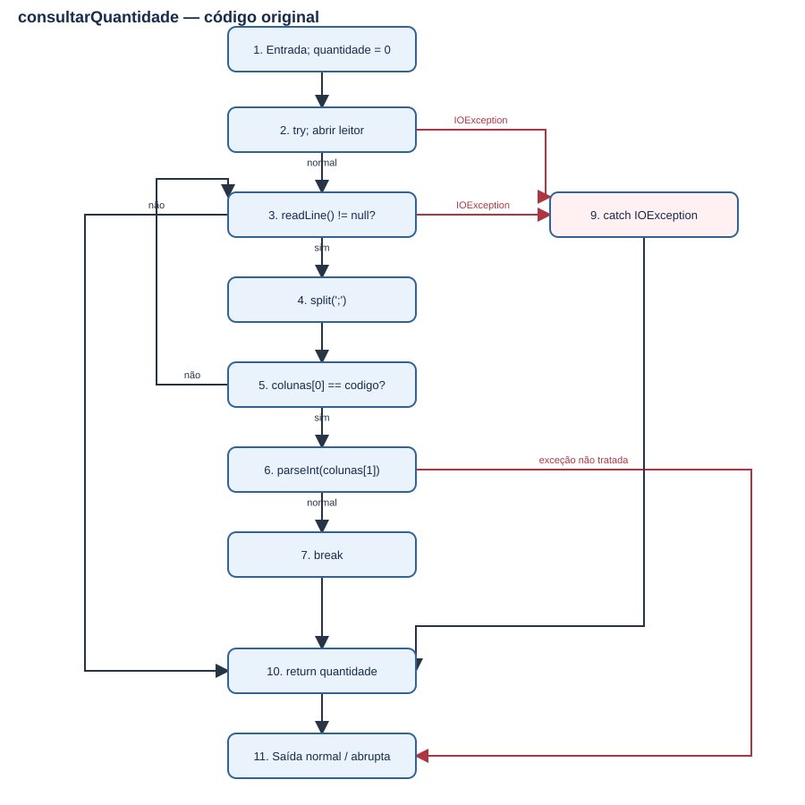
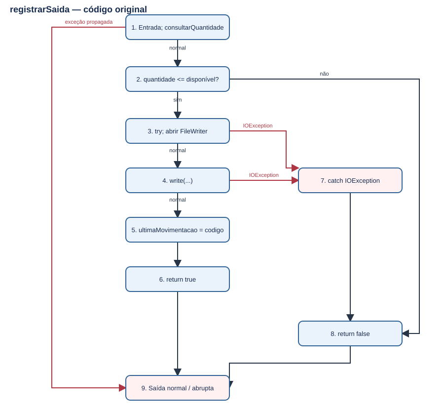

# Análise de caixa branca — cenário 2: estoque por arquivo CSV

## 1. Objetivo e material

Este relatório analisa o código Java do cenário 2 fornecido em imagem. A transcrição em [`original/EstoqueArquivo.java`](original/EstoqueArquivo.java) preserva os comandos e a numeração de linhas da imagem. Os cálculos estruturais desta seção usam **somente o original**. A implementação em [`revisado/EstoqueArquivo.java`](revisado/EstoqueArquivo.java) é separada. O formato do arquivo é uma linha `codigo;quantidade` por produto e o arquivo de movimentações usa `codigo;quantidade` por saída.

O projeto usa Java 21 e Python 3 (somente biblioteca padrão para o programa de testes). Não há dependências de rede nem banco de dados. A planilha [`PLANO_DE_TESTE.xlsx`](PLANO_DE_TESTE.xlsx) contém exclusivamente a aba **CAIXA BRANCO (ESTÁTICO)**, com 18 ocorrências. O modelo da disciplina não estava entre os arquivos fornecidos; por isso a planilha foi criada com as colunas exigidas, sem alegar correspondência visual com o modelo.

## 2. Como executar

Na pasta `atividade-caixa-branca`, rode:

```powershell
python testes/executar.py
```

O programa compila original e revisado em diretórios isolados, cria arquivos temporários para cada caso, compara saída e conteúdo persistido, imprime os resultados e grava [`evidencias/execucao.txt`](evidencias/execucao.txt). Ele retorna código 1 caso alguma verificação de observação falhe.

Para experimentar a versão revisada de forma independente:

```powershell
javac -encoding UTF-8 -d build revisado/EstoqueArquivo.java revisado/Main.java
'A;7' | Set-Content -Encoding utf8 estoque.csv
java -cp build Main estoque.csv movimentacoes.txt consulta A
java -cp build Main estoque.csv movimentacoes.txt saida A 3
Get-Content movimentacoes.txt
```

O resultado da consulta é `7`, a saída retorna `true` e `movimentacoes.txt` recebe `A;3`. O método revisado lança `IOException` para erro de arquivo/formato e `IllegalArgumentException` para entrada inválida. `false` significa apenas indisponibilidade. O comando de exemplo pressupõe PowerShell 7 e um diretório de trabalho gravável.

## 3. Inspeção estática

Cada ocorrência na planilha registra método/linha, trecho ou comportamento, categoria, severidade com justificativa, risco e recomendação. As mais relevantes são:

| ID | Evidência no original | Consequência |
| --- | --- | --- |
| E02 | `catch (IOException)` vazio em `consultarQuantidade`, linhas 22–24 | Arquivo ausente é informado como quantidade zero (O03). |
| E03–E04 | `parseInt(colunas[1])`, linha 18, sem validar duas colunas nem número | CSV malformado propaga exceção não verificada (O04–O05). |
| E09 | `quantidade <= disponivel`, linha 29, sem mínimo positivo | Zero e quantidade negativa são aceitos (O08, O11). |
| E10–E12 | `FileWriter` não fechado e `ultimaMovimentacao` atualizado antes de persistência confirmada, linhas 32–35 | `true` e estado atualizado coexistiram com arquivo vazio (O06). |
| E14 | A saída só acrescenta texto em `movimentacoes.txt` | Consultas posteriores não descontam saídas; o total registrado pode exceder o estoque. |

A planilha também cobre documentação, nomenclatura, legibilidade, responsabilidades, formato CSV, duplicatas, estado, charset, concorrência e caracteres que alteram registros. A severidade **crítica** de E10 decorre da confirmação falsa de persistência observada. E14 e E17 permanecem riscos de negócio relevantes na versão revisada, conforme as limitações.

## 4. Convenções dos grafos do código original

Cada caixa numerada é um nó. As linhas são arestas dirigidas; vermelho representa fluxo excepcional. Entrada, saída, comandos sequenciais, `while`, `if`, `break`, `return`, abertura/leitura/escrita e `catch` são explícitos. A saída terminal é compartilhada pelos retornos normais e pelas exceções não capturadas. Cada grafo tem um componente conectado, portanto `P = 1`. Uma iteração adicional repete arestas; não cria novo caminho básico independente.

Em `consultarQuantidade`, `IOException` pode ocorrer ao abrir o leitor (2→9) ou em `readLine()` (3→9) e é capturada. `NumberFormatException` ou `ArrayIndexOutOfBoundsException` em `parseInt(colunas[1])` sai abruptamente (6→11); ambas são subclasses não verificadas e não entram no `catch (IOException)`. Em `registrarSaida`, uma exceção não verificada propagada pela consulta inicial segue 1→9. `IOException` ao abrir o `FileWriter` segue 3→7 e durante `write` segue 4→7. O código original não fecha o escritor, portanto não há nó de `close` nem aresta para erro de fechamento. Erros como falha de alocação de memória não foram modelados.

### 4.1 `consultarQuantidade(String codigo)`



Fonte editável: [`diagramas/gerar.py`](diagramas/gerar.py). Nós: 1 entrada/inicialização; 2 abertura; 3 condição e leitura do laço; 4 divisão da linha; 5 comparação do código; 6 conversão; 7 `break`; 9 `catch`; 10 `return`; 11 saída.

**Arestas (14):** 1→2; 2→3, 2→9; 3→4, 3→10, 3→9; 4→5; 5→6, 5→3; 6→7, 6→11; 7→10; 9→10; 10→11. **Nós (10), arestas (14), P (1):** `V(G) = E - N + 2P = 14 - 10 + 2 = 6`. Checagem alternativa: cinco desvios binários sobre o fluxo básico — término do `while`, condição do `if`, abertura com `IOException`, leitura com `IOException` e saída excepcional da conversão — resultam em `1 + 5 = 6`. Cruzamentos gráficos de linhas não criam nós ou regiões na topologia.

| Caminho | Nós | Condição representativa |
| --- | --- | --- |
| C1 | 1–2–3–10–11 | Arquivo vazio; término do laço sem iteração. |
| C2 | 1–2–3–4–5–3–10–11 | Linha com outro código e depois fim do arquivo; uma iteração sem correspondência. |
| C3 | 1–2–3–4–5–6–7–10–11 | Código encontrado, número válido, `break`. |
| C4 | 1–2–9–10–11 | `IOException` ao abrir, por exemplo arquivo ausente. |
| C5 | 1–2–3–9–10–11 | `IOException` durante leitura. |
| C6 | 1–2–3–4–5–6–11 | Código encontrado, quantidade inválida ou coluna faltante; saída abrupta. |

Os seis caminhos acrescentam, cada um, ao menos uma aresta ainda ausente do conjunto anterior: respectivamente 3→10, 5→3, 6→7, 2→9, 3→9 e 6→11. Assim são linearmente independentes. Há outros caminhos concretos, sobretudo com mais iterações, que não são necessários para a base.

### 4.2 `registrarSaida(String codigo, int quantidade)`



Nós: 1 chamada à consulta; 2 condição de disponibilidade; 3 abertura do escritor; 4 escrita; 5 atualização do atributo; 6 `return true`; 7 `catch`; 8 `return false`; 9 saída.

**Arestas (12):** 1→2, 1→9; 2→3, 2→8; 3→4, 3→7; 4→5, 4→7; 5→6; 6→9; 7→8; 8→9. **Nós (9), arestas (12), P (1):** `V(G) = 12 - 9 + 2 = 5`. Checagem alternativa: condição do `if`, exceção na abertura, exceção na escrita e exceção propagada da consulta somam quatro desvios sobre o caminho básico: `1 + 4 = 5`.

| Caminho | Nós | Condição representativa |
| --- | --- | --- |
| S1 | 1–2–8–9 | Quantidade maior que a disponível; `false`. |
| S2 | 1–2–3–4–5–6–9 | Quantidade aceita e `write` retorna sem exceção; `true`. |
| S3 | 1–2–3–7–8–9 | `IOException` ao abrir o arquivo de movimentos. |
| S4 | 1–2–3–4–7–8–9 | `IOException` durante `write`. |
| S5 | 1–9 | Consulta inicial propaga exceção não verificada de CSV malformado. |

Cada caminho acrescenta uma aresta própria: 2→8, 5→6, 3→7, 4→7 e 1→9. A chamada do nó 1 usa o fluxo do primeiro grafo: ausência do arquivo é absorvida e vira `0`; uma quantidade malformada no código procurado pode interromper `registrarSaida` antes do `if`.

### Arestas difíceis de induzir

C5 depende de falha de leitura **após** a abertura; S4 depende de falha em `write` **após** abrir. Os casos de arquivo ausente e caminho ocupado por diretório exercitam C4 e S3, não C5/S4. Para C5/S4, uma evolução testável poderia injetar `Reader`/`Writer` que lançam `IOException` em chamadas programadas, ou usar um sistema de arquivos simulado. Isso exigiria um ponto de injeção no original ou instrumentação. Não se afirma cobertura dessas arestas no ensaio executado.

## 5. Matriz de casos e resultados

Todos os casos foram **executados** por `testes/executar.py`; a coluna situação julga o comportamento funcional frente ao resultado desejado. Na coluna método, **consulta** significa `consultarQuantidade` e **saída** significa `registrarSaida`. O programa de testes também confere que a **observação** bate com a saída registrada, inclusive nos defeitos do original. A evidência de cada linha é o registro com o mesmo ID em [`evidencias/execucao.txt`](evidencias/execucao.txt). `sem arquivo` significa ausência de `movimentacoes.txt`; `vazio` significa arquivo criado com zero bytes. Cada caso usa diretório temporário isolado.

| ID | Método / caminho | Entrada e pré-condição | Resultado esperado funcional | Resultado observado | Situação |
| --- | --- | --- | --- | --- | --- |
| O01 | consulta / C3 | `A`; CSV `A;7`, `B;2` | 7 | 7 | Passou |
| O02 | consulta / C2→C1 | `Z`; CSV `A;7` | 0 | 0 | Passou |
| O03 | consulta / C4 | `A`; CSV ausente | Erro explícito | 0 | Falhou |
| O04 | consulta / C6 | `A`; CSV `A;abc` | Erro de formato contextualizado | `NumberFormatException` | Falhou |
| O05 | consulta / C6 | `A`; CSV `A` | Erro de formato contextualizado | `ArrayIndexOutOfBoundsException` | Falhou |
| O06 | saída / S2 | `A,3`; CSV `A;7`; movimentos ausente | `true`, arquivo `A;3`, última `A` | `true`, arquivo vazio, última `A` | Falhou |
| O07 | saída / S1 | `A,8`; CSV `A;7` | `false`, sem arquivo | `false`, sem arquivo | Passou |
| O08 | saída / S2 | `A,-2`; CSV `A;7` | Entrada rejeitada | `true`, arquivo vazio, última `A` | Falhou |
| O09 | saída / S3 | `A,1`; CSV `A;7`; destino é diretório | Erro explícito | `false`, última vazia | Falhou |
| O10 | saída / S5 | `A,1`; CSV `A;abc` | Erro de formato contextualizado | `NumberFormatException` | Falhou |
| O11 | saída / S2 | `A,0`; CSV `A;7` | Entrada rejeitada | `true`, arquivo vazio, última `A` | Falhou |
| R01 | consulta / equivalente C3 | `A`; CSV `A;7`, `B;2` | 7 | 7 | Passou |
| R02 | consulta / equivalente C2→C1 | `Z`; CSV `A;7` | 0 | 0 | Passou |
| R03 | consulta / erro de abertura | `A`; CSV ausente | `IOException` | `NoSuchFileException` | Passou |
| R04 | consulta / formato | `A`; CSV `A;abc` | `IOException` | `IOException` | Passou |
| R05 | consulta / formato | `A`; CSV `A` | `IOException` | `IOException` | Passou |
| R06 | saída / sucesso | `A,3`; CSV `A;7` | `true`, arquivo `A;3`, última `A` | Igual ao esperado | Passou |
| R07 | saída / insuficiente | `A,8`; CSV `A;7` | `false`, sem arquivo | Igual ao esperado | Passou |
| R08 | saída / quantidade negativa | `A,-2`; CSV `A;7` | `IllegalArgumentException`, sem arquivo | Igual ao esperado | Passou |
| R09 | saída / zero | `A,0`; CSV `A;7` | `IllegalArgumentException`, sem arquivo | Igual ao esperado | Passou |
| R10 | saída / erro de abertura | `A,1`; CSV `A;7`; destino é diretório | `IOException`, última vazia | `AccessDeniedException` nesta máquina | Passou |
| R11 | saída / código inválido | código `null`, quantidade 1; CSV `A;7` | `IllegalArgumentException` | Igual ao esperado | Passou |
| R12 | saída / limite inclusivo | `A,7`; CSV `A;7` | `true`, arquivo `A;7` | Igual ao esperado | Passou |
| R13 | consulta / linha anterior inválida | `A`; CSV `B;abc`, `A;7` | `IOException` | `IOException` | Passou |
| R14 | saída / erro da consulta | `A,1`; CSV `A;abc` | `IOException`, sem arquivo | Igual ao esperado | Passou |

O programa de testes terminou com **25/25 verificações de observação**. Isso não significa 25 requisitos funcionais aprovados: o original falha nos casos marcados acima. O arquivo vazio em O06/O08/O11 foi observado nesta execução com OpenJDK 21 no Windows; a ausência de `close` torna a persistência não garantida em qualquer ambiente.

## 6. Correções e comparação

| Aspecto | Original | Revisado |
| --- | --- | --- |
| Recursos e persistência | Leitor/escritor abertos sem fechamento; sucesso antes de descarregar buffer. | `try-with-resources`; sucesso e estado somente após fechamento do escritor. |
| Erros | `IOException` ignorada; erro de CSV não verificado. | `IOException` propagada, com linha e causa para formato inválido. |
| Validação | Zero/negativo e código com delimitador aceitos. | Exige saída positiva e código não vazio sem `;` ou quebra de linha. |
| Charset e caminhos | Charset padrão e nomes de arquivo fixos. | UTF-8 e `Path` recebidos no construtor. |
| Leitura do CSV | Confia em `colunas[1]`; primeira ocorrência vence. | Exige duas colunas e inteiro não negativo; primeira ocorrência ainda vence. |
| Concorrência | Sem sincronização. | `synchronized` limita interleaving entre chamadas à **mesma instância**. |

A estrutura do revisado mudou para validação explícita e fechamento automático. Seu `V(G)` não foi usado para cumprir a análise da Etapa 2; reduzir complexidade não era condição da correção. Os testes R03–R06, R08–R11 e R14 comprovam as correções de maior risco observáveis.

## 7. Limitações

O revisado mantém `estoque.csv` como fonte imutável e apenas acrescenta movimentações. Assim, **não** implementa baixa transacional de estoque: saídas sucessivas ou processos simultâneos ainda podem superar o saldo. Para uso real, seria necessário definir a regra de saldo e gravar consulta e baixa atomicamente em armazenamento apropriado. O `synchronized` cobre uma única instância Java, não processos ou instâncias diferentes.

O CSV aceito é deliberadamente simples: exatamente duas colunas separadas por `;`, sem escape ou cabeçalho; código duplicado usa a primeira ocorrência. O teste não simula falha durante `readLine` ou `write`. O plano está na aba exigida, mas não utiliza o layout do modelo da disciplina porque ele não foi fornecido. A publicação em GitHub e o envio na plataforma dependem das credenciais e da decisão de entrega do estudante; este diretório contém os arquivos preparados para isso.

## 8. Conclusão e referências

O original apresenta falhas reproduzidas de persistência, validação e tratamento de erros. A revisão corrige essas falhas locais e separa falha operacional de indisponibilidade. O risco de consistência de estoque entre operações permanece e está declarado acima. Referências utilizadas: código-base em imagem e enunciado fornecidos pelo usuário. Os resultados empíricos estão registrados em [`evidencias/execucao.txt`](evidencias/execucao.txt).
